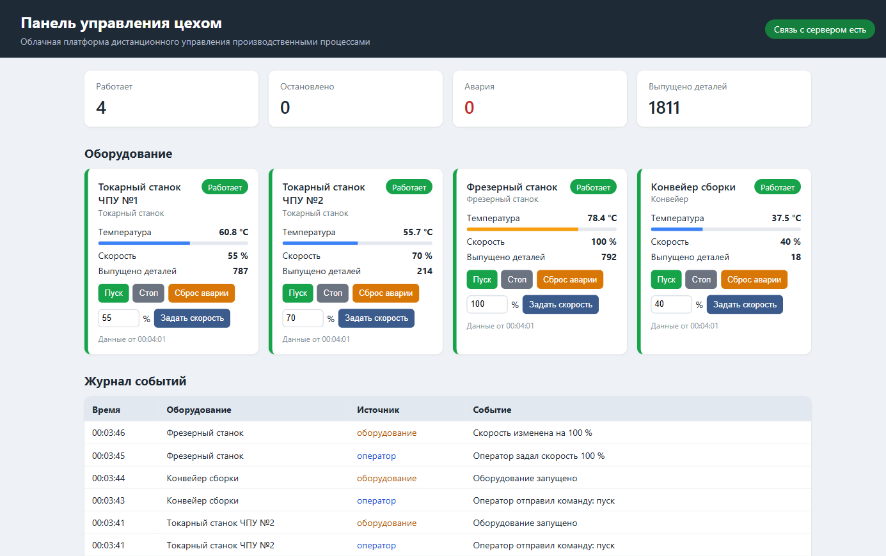
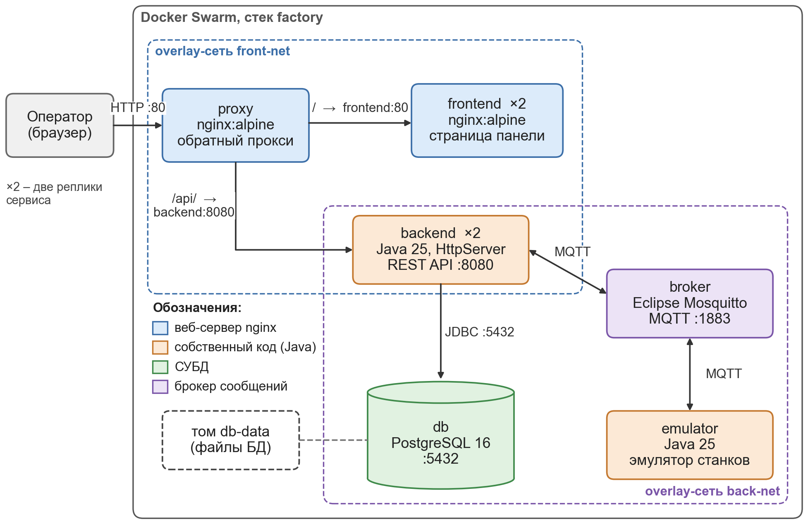

# Облачная платформа для дистанционного управления производственными процессами

Курсовая работа по дисциплине «Настройка и администрирование сервисного программного обеспечения».
Студент: Малышев А. А., группа ИКБО-10-25.

Платформа показывает в браузере состояние оборудования цеха (станки, конвейер) и позволяет
удалённо отправлять ему команды: пуск, стоп, сброс аварии, изменение скорости.
Вместо настоящих станков работает эмулятор, который присылает телеметрию через MQTT-брокер.



## Архитектура



## Контейнеры

| Сервис   | Образ                          | Назначение |
|----------|--------------------------------|------------|
| proxy    | nginx:alpine                   | обратный прокси, единственная точка входа (порт 80) |
| frontend | nginx:alpine                   | веб-панель оператора (HTML, CSS, JavaScript) |
| backend  | eclipse-temurin:25-jre-alpine  | сервер управления на Java: REST API, запись в БД, отправка команд |
| db       | postgres:16-alpine             | база данных: оборудование и журнал событий |
| broker   | eclipse-mosquitto:2            | брокер сообщений MQTT |
| emulator | eclipse-temurin:25-jre-alpine  | эмулятор оборудования на Java |

Сети: `front-net` (proxy, frontend, backend) и `back-net` (backend, db, broker, emulator).
База данных и брокер наружу не открыты.

## Структура проекта

```
backend/      сервер управления (Java, Maven)
emulator/     эмулятор оборудования (Java, Maven)
frontend/     веб-панель и конфигурация nginx
proxy/        конфигурация обратного прокси
db/           скрипт создания таблиц
broker/       конфигурация Mosquitto
.github/workflows/ci-cd.yml   конвейер CI/CD
docker-compose.yaml           описание всех сервисов (для сборки и для Swarm)
```

## Запуск

Нужен Docker Desktop. В командной строке (cmd) из папки проекта:

```
deploy.bat
```

Скрипт создаёт кластер Swarm (если его ещё нет), собирает образы и разворачивает стек `factory`.
После запуска панель открывается по адресу http://localhost.

Те же действия вручную:

```
docker swarm init
docker compose build
docker stack deploy --resolve-image never -c docker-compose.yaml factory
docker service ls
```

Остановка: `stop.bat` или `docker stack rm factory`.

Масштабирование, например, до трёх копий сервера управления:

```
docker service scale factory_backend=3
```

## API

| Метод | Адрес                         | Описание |
|-------|-------------------------------|----------|
| GET   | /api/health                   | состояние подключения к БД и брокеру |
| GET   | /api/machines                 | список оборудования с последней телеметрией |
| GET   | /api/events                   | последние 20 записей журнала |
| POST  | /api/machines/{id}/command    | команда, тело `{"action":"start"}`, `stop`, `reset` или `{"action":"speed","value":70}` |

## CI/CD

При пуше в ветку `main` GitHub Actions выполняет три этапа:

1. **Тесты** — JUnit-тесты сервера управления и эмулятора.
2. **Сборка и публикация** — сборка шести образов и загрузка в GitHub Container Registry (ghcr.io).
3. **Деплой** — создание кластера Swarm на сервере GitHub, развёртывание стека из опубликованных образов
   и проверка: открывается панель, работает API, команда доходит до эмулятора.
